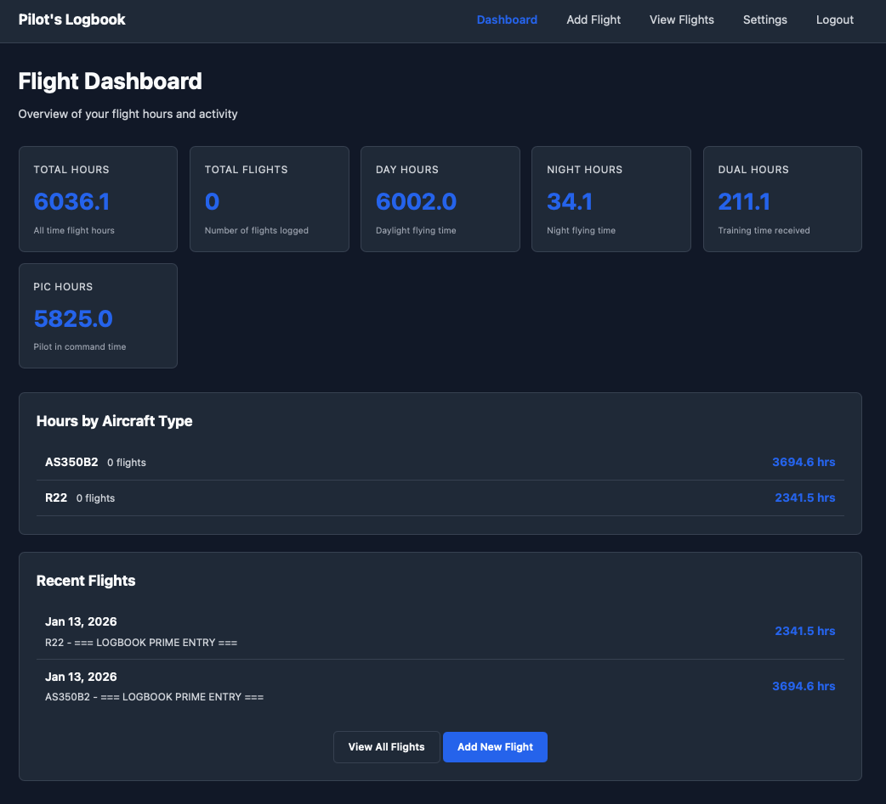
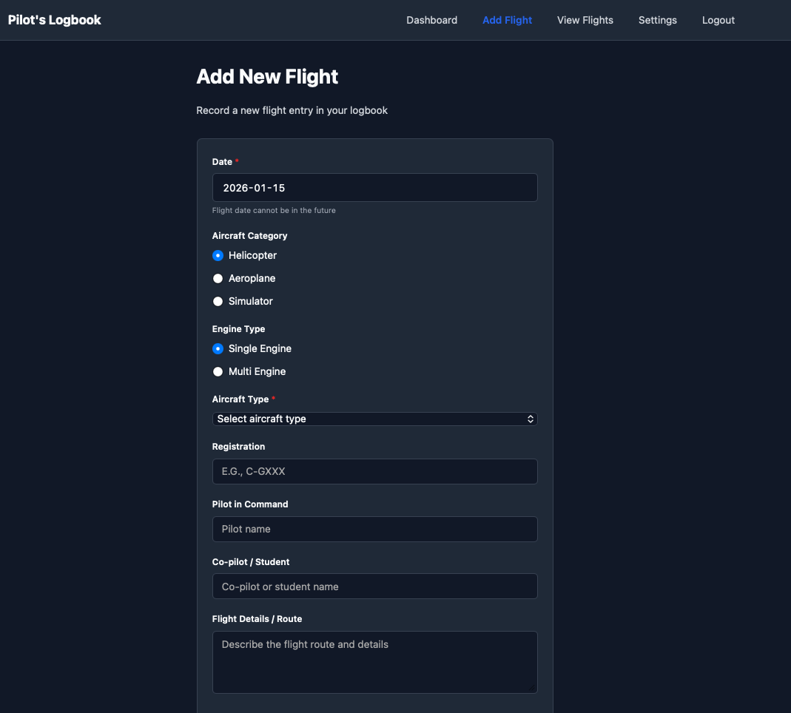
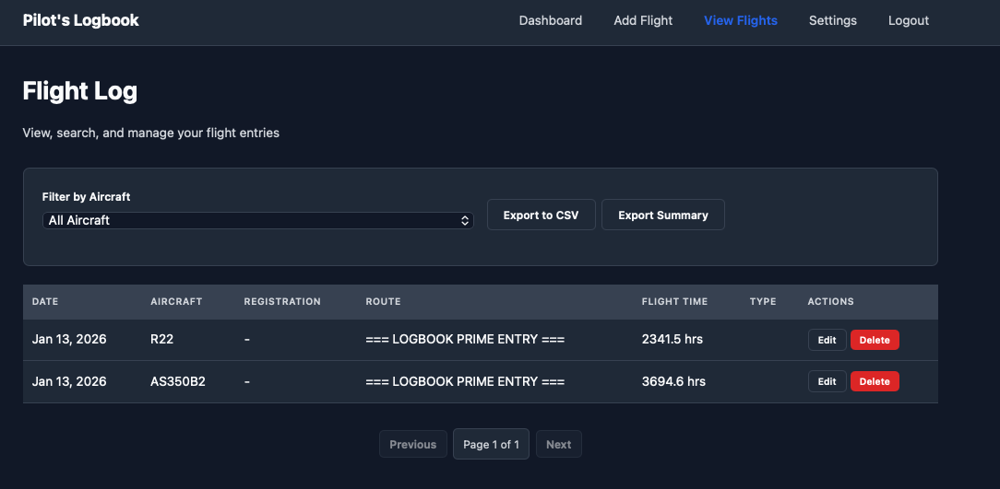
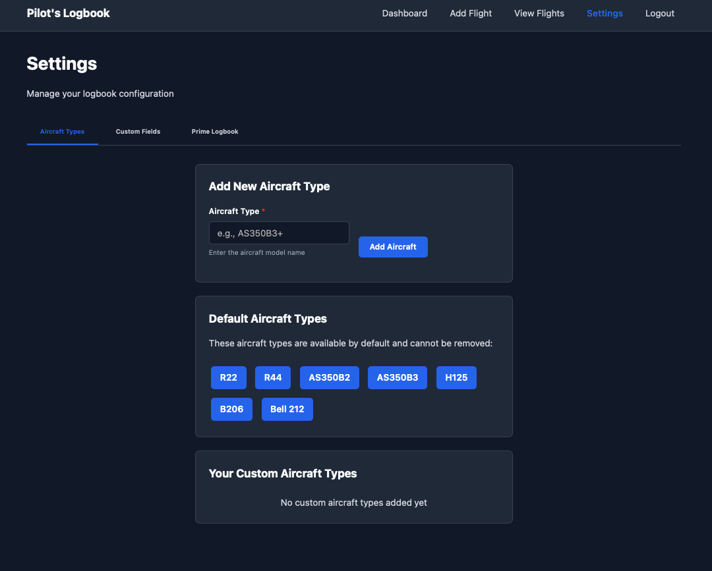

# Heli Logbook

A self-hosted web application for pilots to track and manage their flight hours. Built with simplicity and mobile accessibility in mind.

## Features

- **Flight Entry Management**: Record detailed flight information including aircraft type, registration, route, and flight times
- **Custom Aircraft Types**: Track any aircraft - comes with common defaults, but you can add unlimited custom aircraft types
- **Dashboard**: View total flight hours, flight counts, and hours broken down by aircraft type
- **Flight Log**: Browse, search, filter, and manage all flight entries
- **CSV Export**: Export your flight data for backup or external analysis
- **Mobile-Responsive**: Optimized for field entry on mobile devices
- **Dark Mode**: Automatic dark mode support based on system preferences
- **Single User Authentication**: Simple session-based login for personal use

## Aircraft Profiles

Open **Settings → Aircraft Profiles** to save a registration with its aircraft type, category and engine configuration. Nickname, operator and **Engine model** are optional. Engine model is free text (up to 100 characters), for example `2B` or `2B1` for AS350B3 variants; it is separate from the Single Engine / Multi Engine configuration. It appears in profile labels/search and flight details and is saved as part of each flight's historical snapshot. Mark favourites for quicker selection, and optionally choose one default for fresh, blank new-flight forms.

On **Add Flight**, search/select a profile to fill and lock the aircraft details. Choose **Manual entry** to keep those displayed details and edit them independently. Recent use is recorded when a flight is saved. Existing Aircraft Types management remains available separately.

Saved flights retain their own aircraft-detail snapshots: changing or archiving a profile never rewrites those flights. Editing a linked historical flight shows **Saved flight details**, not the profile's latest values. Duplicating a flight with a changed, archived or unavailable profile safely switches to manual entry rather than substituting new details. Archive profiles to hide them from new-flight choices; enable **Include archived profiles** in Settings to restore them.

The v1.9.1 engine-model migration is additive and idempotent: existing profiles and flights have a blank/unknown model, with no inferred values or rewritten history. Legacy flight updates that omit `engine_model` preserve its saved value. The v1.9.0 profile migration is additive. It does not infer profiles or link/rewrite existing flights; create profiles deliberately after upgrading. Database backups include profiles. Older flight APIs and manual entry remain compatible.

## ICAO aircraft reference (v1.10.0)

In **Settings → Aircraft Profiles**, use the optional **ICAO aircraft reference** section:

1. Search by ICAO designator, manufacturer or model. Helicopters are the default; enable **All aircraft** to broaden the reference search. Search is case-insensitive and ignores spaces/hyphens for matching only (`H125` finds `H-125`, `AS350` finds `AS-350`); published names are kept intact. It is local and returns up to 100 matching aliases; narrow the query when more matches exist.
2. Choose a manufacturer/model alias in the native selector. A shared ICAO code (such as AS50) can have multiple aliases; choosing one does not identify an exact variant or installed engine. Search and selection alone never change the draft.
3. Use **Replace type, category & engine count in draft** only when you intend to replace those draft fields, including during an existing-profile edit. The model becomes the editable Aircraft Type; models longer than the existing 50-character limit use the ICAO designator instead, with an explanatory message. Supported categories map to Helicopter/Aeroplane; unsupported categories and unknown engine counts keep their current draft values and are announced. Known engine counts map only to Single Engine/Multi Engine. A generic turbine/piston/jet class is **never** an exact engine model.
4. Verify/refine the exact variant manually, enter the registration and any installed engine model, then save the profile separately. Engine model and all unrelated fields are never changed by the reference. Clear reference selection cancels suggestions without undoing or saving draft values. Cancel Edit discards the edit as before.

Manual entry remains available if the catalogue is missing or unavailable. Delayed searches never prefill anything automatically; editing, cancelling, saving or changing a query invalidates pending suggestions. There are no new database columns or migrations in v1.10.0, no automatic profile creation, and no changes to saved flight snapshots.

The nearby FAA provenance link identifies the reference source/edition. The application reads the bundled `src/data/aircraft-types.json`; no upstream network access is required at runtime. The file uses `{source:{title,url,edition,...},aircraft:[{icao,manufacturer,model,category,engineCount,engineType,wakeCategory}]}`. Keep distinct manufacturer/model aliases for the same ICAO designator. Production builds must include the reviewed FAA dataset; the synthetic rows in tests are deliberately test-only, never a fallback catalogue. Restart after replacing the bundled catalogue.

**Authenticated API:** `GET /api/aircraft-reference?q=AS50&category=helicopter` (`category=all` is optional). Returns `{source,aircraft,total}` with at most 100 rows and the full matching `total`. Queries are limited to 100 characters; invalid query shapes/categories return 400, unauthenticated access returns 401, and unavailable local data returns 503. The endpoint is read-only and never inserts Aircraft Types, profiles or flights.

**Tests:** `npm test` runs smoke/integration, migration/snapshot and UI-controller tests, including reference auth/search/filter/aliases, read-only database snapshots, explicit draft selection, manual/edit/cancel/error flows and delayed/superseded responses. Browser/theme and migration rehearsal against private production snapshots should be performed before deployment.

## Screenshots

| Dashboard | Add Flight |
|:---------:|:----------:|
|  |  |

| Flight Log | Settings |
|:----------:|:--------:|
|  |  |

## Technology Stack

- **Backend**: Node.js + Express
- **Database**: SQLite (with easy migration path to PostgreSQL)
- **Frontend**: Vanilla HTML/CSS/JavaScript (lightweight, no framework dependencies)
- **Authentication**: Session-based authentication with bcrypt password hashing
- **Container**: Docker + Docker Compose

## Quick Start (For Users)

### Prerequisites

- Docker and Docker Compose installed on your system
- A Linux/Unix environment (or Windows with WSL2)

### Installation

1. **Download the docker-compose.yml file**:
   ```bash
   mkdir -p ~/logbook && cd ~/logbook
   curl -O https://raw.githubusercontent.com/penguinator13/pilots-logbook/main/docker-compose.yml
   curl -O https://raw.githubusercontent.com/penguinator13/pilots-logbook/main/.env.example
   ```

2. **Create your `.env` file**:
   ```bash
   cp .env.example .env
   nano .env  # or use your preferred editor
   ```

   **Important**: Change these values:
   - `SESSION_SECRET` - Generate with: `openssl rand -hex 32`
   - `ADMIN_USERNAME` - Your desired username
   - `ADMIN_PASSWORD` - Your secure password
   - `HOST_PORT` - Change if port 3000 is already in use

3. **Create the data directory**:
   ```bash
   mkdir -p data
   ```

4. **Start the application**:
   ```bash
   docker-compose pull
   docker-compose up -d
   ```

5. **Access the application**:
   - Open your browser and navigate to `http://localhost:3000` (or your configured `HOST_PORT`)
   - Login with your credentials from the `.env` file
   - Start logging flights!

### Using Pre-built Docker Image

The application is available as a pre-built Docker image at `ghcr.io/penguinator13/pilots-logbook:latest`

You can also run it directly with Docker:
```bash
docker pull ghcr.io/penguinator13/pilots-logbook:latest

docker run -d \
  --name pilots-logbook \
  -p 3000:3000 \
  -v $(pwd)/data:/app/data \
  -e SESSION_SECRET="your-random-secret" \
  -e ADMIN_USERNAME="your-username" \
  -e ADMIN_PASSWORD="your-password" \
  --restart unless-stopped \
  ghcr.io/penguinator13/pilots-logbook:latest
```

## Configuration

### Environment Variables

All configuration is done through environment variables. Create a `.env` file (use `.env.example` as a template):

| Variable | Description | Default |
|----------|-------------|---------|
| `SESSION_SECRET` | Secret key for session encryption | (required - change this!) |
| `ADMIN_USERNAME` | Initial admin username | `admin` |
| `ADMIN_PASSWORD` | Initial admin password (first run only). If unset, a random one is generated and printed in the logs | *(generated)* |
| `PORT` | Internal application port | `3000` |
| `HOST_PORT` | External port to access app | `3000` |
| `DB_PATH` | Path to SQLite database (inside container) | `/app/data/logbook.db` |
| `DATA_PATH` | Path to data directory on host | `./data` |
| `CONTAINER_NAME` | Docker container name | `pilots-logbook` |
| `TRUST_PROXY` | Enable secure cookies for reverse proxy | `false` |
| `TZ` | Timezone for timestamps | `America/Vancouver` |

### Port Configuration

To use a different port (e.g., if 3000 is already in use), set in your `.env` file:

```bash
HOST_PORT=8080  # Access via http://localhost:8080
PORT=3000       # Internal container port (usually leave as 3000)
```

Then restart: `docker-compose down && docker-compose up -d`

## Reverse Proxy Configuration

### Direct Access (Default)

If you're accessing the application directly via HTTP (e.g., `http://localhost:3000` or `http://raspberry-pi:3000`), use the **default settings**:

```bash
# .env
TRUST_PROXY=false
```

This is the correct configuration for:
- Local development
- Docker port mapping without reverse proxy
- Raspberry Pi deployments
- Direct LAN access

### Behind Reverse Proxy (nginx, Cloudflare Tunnel, Traefik)

If you're using a reverse proxy that terminates SSL/TLS (e.g., nginx with HTTPS, Cloudflare Tunnel), set:

```bash
# .env
TRUST_PROXY=true
```

This enables secure session cookies that require HTTPS. Your reverse proxy configuration should:

1. **Handle HTTPS termination** (SSL certificates)
2. **Forward requests to container over HTTP** (proxy_pass to http://localhost:3000)
3. **Set proxy headers** (X-Forwarded-Proto, X-Forwarded-For)

#### Example nginx configuration:

```nginx
server {
    listen 443 ssl http2;
    server_name logbook.example.com;

    ssl_certificate /path/to/cert.pem;
    ssl_certificate_key /path/to/key.pem;

    location / {
        proxy_pass http://localhost:3000;
        proxy_set_header Host $host;
        proxy_set_header X-Real-IP $remote_addr;
        proxy_set_header X-Forwarded-For $proxy_add_x_forwarded_for;
        proxy_set_header X-Forwarded-Proto $scheme;
    }
}
```

#### Example Cloudflare Tunnel configuration:

```yaml
tunnel: <your-tunnel-id>
credentials-file: /path/to/credentials.json

ingress:
  - hostname: logbook.example.com
    service: http://localhost:3000
  - service: http_status:404
```

With Cloudflare Tunnel, set `TRUST_PROXY=true` in your `.env` file.

### Troubleshooting: 401 Unauthorized Errors

**Symptom:** After login, you're redirected to dashboard but immediately see 401 errors and can't access any data.

**Cause:** `TRUST_PROXY=true` is set but you're accessing over HTTP (not through a reverse proxy).

**Fix:**
1. Set `TRUST_PROXY=false` in your `.env` file
2. Restart the container: `docker-compose down && docker-compose up -d`

**Why this happens:**
- When `TRUST_PROXY=true` in production mode, session cookies are marked as "secure" (HTTPS-only)
- Browsers refuse to send secure cookies over plain HTTP connections
- Without the session cookie, the server treats you as unauthenticated → 401 errors

## Usage

### Adding a Flight

1. Click **Add Flight** in the navigation
2. Fill out the flight details:
   - **Required**: Date, Aircraft Type, Flight Time
   - **Optional**: Registration, Pilot names, Route, Day/Night breakdown, etc.
3. Click **Add Flight** to save

### Viewing Flights

1. Click **View Flights** in the navigation
2. Use the aircraft filter to narrow down results
3. Click **Edit** to modify a flight entry
4. Click **Delete** to remove a flight entry (with confirmation)

### Exporting Data

1. Go to **View Flights**
2. Optionally filter by aircraft type
3. Click **Export to CSV** to download your flight data

### Dashboard

The dashboard shows:
- Total flight hours (all time)
- Total number of flights
- Day vs Night hours breakdown
- Hours by aircraft type
- Recent 10 flights

## Backup & Restore

### Backing Up Your Data

**From the app** (easiest): Settings > Account > **Download Database Backup**. This uses SQLite's online-backup API, so it is a consistent snapshot even while the app is running. The same endpoint is available at `GET /api/backup/db` for scripted pulls with a logged-in session.

**Manual Backup** (on the host, database is in WAL mode so use sqlite's backup command rather than a plain `cp` while the app is running):
```bash
sqlite3 ./data/logbook.db ".backup ./backups/logbook-$(date +%F).db"
```

**Automated Backup** (using cron):
```bash
# Add to crontab
0 2 * * * sqlite3 /path/to/logbook/data/logbook.db ".backup /path/to/backups/logbook-$(date +\%F).db"
```

### Restoring from Backup

```bash
# Stop the application
docker-compose down

# Restore the database
cp ./data/logbook.db.backup ./data/logbook.db

# Start the application
docker-compose up -d
```

### Offsite Backup

Consider backing up to TrueNAS, cloud storage, or another system:

```bash
# Example: Copy to TrueNAS share
cp ./data/logbook.db /mnt/truenas/backups/logbook/logbook.db.$(date +%Y%m%d)
```

## Deployment Options

### Local Network Access

The application is accessible on your local network at `http://[server-ip]:3000`

### Reverse Proxy with Nginx

Example Nginx configuration:

```nginx
server {
    listen 80;
    server_name logbook.yourdomain.com;

    location / {
        proxy_pass http://localhost:3000;
        proxy_http_version 1.1;
        proxy_set_header Upgrade $http_upgrade;
        proxy_set_header Connection 'upgrade';
        proxy_set_header Host $host;
        proxy_cache_bypass $http_upgrade;
        proxy_set_header X-Real-IP $remote_addr;
        proxy_set_header X-Forwarded-For $proxy_add_x_forwarded_for;
        proxy_set_header X-Forwarded-Proto $scheme;
    }
}
```

### Cloudflare Tunnel

1. Install Cloudflare Tunnel on your homelab
2. Create a tunnel pointing to `http://localhost:3000`
3. Access your logbook from anywhere via your Cloudflare domain

### Docker Run (without Docker Compose)

```bash
docker build -t helicopter-logbook .

docker run -d \
  --name helicopter-logbook \
  -p 3000:3000 \
  -v $(pwd)/data:/data \
  -e SESSION_SECRET="your-random-secret" \
  -e ADMIN_USERNAME="your-username" \
  -e ADMIN_PASSWORD="your-password" \
  --restart unless-stopped \
  helicopter-logbook
```

## Updating the Application

### For Users (Using Pre-built Image)

```bash
# Pull the latest image
docker-compose pull

# Restart with new version
docker-compose up -d
```

Your data in `./data/logbook.db` will be preserved.

### For Developers (Building from Source)

```bash
# Pull the latest code
git pull

# Rebuild and restart
docker-compose down
docker-compose build
docker-compose up -d
```

## Troubleshooting

### Container won't start

Check the logs:
```bash
docker-compose logs -f
```

### Can't login

1. Check your credentials in the `.env` file or `docker-compose.yml`
2. The default username is `admin`; the initial password is whatever `ADMIN_PASSWORD` was at first run, or the generated one printed in the startup logs (`docker compose logs logbook`)
3. Rebuild the container if you changed credentials:
   ```bash
   docker-compose down
   docker-compose up -d --build
   ```

### Database is locked

This usually happens if the container didn't shut down cleanly:
```bash
docker-compose down
docker-compose up -d
```

### Permission errors with data directory

Ensure the data directory is writable:
```bash
chmod 777 ./data
```

## Database Schema

The application uses SQLite with the following tables:

### Users Table
- `id`: Primary key
- `username`: Unique username
- `password`: Bcrypt hashed password
- `created_at`: Account creation timestamp

### Flights Table
- `id`: Primary key
- `date`: Flight date
- `aircraft_type`: Aircraft model
- `registration`: Aircraft registration
- `pic`: Pilot in command name
- `copilot`: Co-pilot/student name
- `route`: Flight route/details
- `flight_time`: Total flight hours
- `day_hours`: Day flying hours
- `night_hours`: Night flying hours
- `flight_type`: Dual, PIC, or Solo
- `longline`: Longline/sling operations flag
- `mountain`: Mountain operations flag
- `instructor`: Instructor role flag
- `takeoffs_day`: Day takeoffs count
- `takeoffs_night`: Night takeoffs count
- `landings_day`: Day landings count
- `landings_night`: Night landings count
- `created_at`: Entry creation timestamp

## Security Considerations

- Change your password after first login under **Settings > Account** (also signs out other devices).
- A liveness endpoint is exposed at `GET /healthz` (no auth, not rate-limited) for Docker/systemd health checks.

1. **Change default credentials** immediately
2. **Use a strong SESSION_SECRET** (at least 32 random characters)
3. **Use HTTPS** if exposing to the internet (via reverse proxy)
4. **Regular backups** of the database file
5. **Keep Docker images updated** for security patches
6. **Limit network access** if only used locally

## Future Enhancements (Not Yet Implemented)

- 90-day currency tracking
- Advanced reporting and analytics
- Excel import functionality
- Multi-user support
- Password reset functionality
- PostgreSQL migration option

## Support

For issues, questions, or contributions, please open an issue in the repository.

## Development

### Building from Source

If you want to contribute or customize the application:

1. **Clone the repository**:
   ```bash
   git clone https://github.com/penguinator13/pilots-logbook.git
   cd pilots-logbook
   ```

2. **Create a `.env` file**:
   ```bash
   cp .env.example .env
   # Edit as needed
   ```

3. **Build and run locally**:
   ```bash
   # Option 1: Using Docker Compose
   docker-compose -f docker-compose.dev.yml up --build

   # Option 2: Build the image
   docker build -t pilots-logbook:dev .
   docker run -p 3000:3000 -v $(pwd)/data:/app/data --env-file .env pilots-logbook:dev
   ```

### Building Multi-Platform Images

To build for both AMD64 (servers) and ARM64 (Apple Silicon):

```bash
# Create a multi-platform builder
docker buildx create --use --name multiplatform

# Build and push for both architectures
docker buildx build --platform linux/amd64,linux/arm64 \
  -t ghcr.io/penguinator13/pilots-logbook:latest \
  --push .
```

### Project Structure

```
pilots-logbook/
├── src/
│   ├── server.js          # Express server entry point
│   ├── models/
│   │   └── database.js    # SQLite schema & initialization
│   ├── middleware/
│   │   └── auth.js        # Authentication middleware
│   ├── routes/
│   │   ├── auth.js        # Login/logout endpoints
│   │   ├── flights.js     # Flight CRUD & stats
│   │   └── aircraft.js    # Custom aircraft management
│   └── public/
│       ├── *.html         # Frontend pages
│       ├── css/
│       │   └── styles.css
│       └── js/
│           └── *.js       # Frontend JavaScript
├── data/                  # SQLite database (gitignored)
├── Dockerfile             # Production container
├── docker-compose.yml     # Deployment configuration
├── package.json           # Node.js dependencies
└── README.md
```

### Contributing

Contributions are welcome! Please feel free to submit issues or pull requests.

## Maintenance Status

⚠️ **Personal Project**: This is a personal project built for my own use. I'm sharing it publicly because other pilots might find it useful, but I make no promises about updates, support, or new features.

- ✅ Works great for my needs (as of January 2026)
- ✅ Pull requests welcome - I'll review when I can
- ✅ Community contributions encouraged
- ⚠️ Issues may not get immediate responses
- ⚠️ Updates happen when *I* need new features
- 🤝 **Feel free to fork and maintain your own version!**

If this project becomes popular and you want to maintain an active fork, let me know and I'll link to it here.

## License

MIT License - See LICENSE file for details.

This project is provided as-is for personal use. Do whatever you want with it!

---

**Built by a helicopter pilot, for pilots who value simplicity and reliability.**
